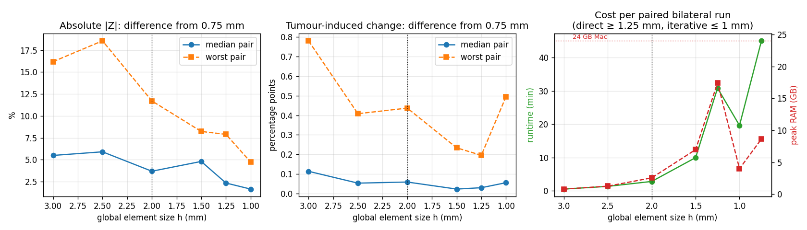
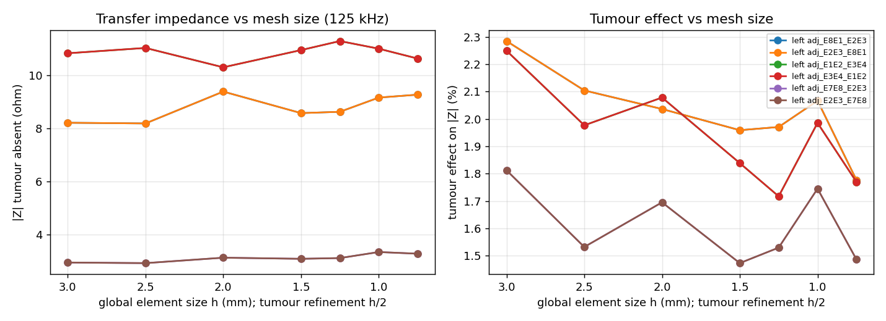

# Breast Lesion Simulator (`breastsim`)

Physics-based 3D simulator of the **complex transfer impedance** a wearable breast-bioimpedance device would
record through surface electrodes, with and without an inserted tumour.

- 3D frequency-domain electroquasistatic FEM, \(\nabla\cdot[(\sigma+j\omega\varepsilon)\nabla V]=0\), P1 tetrahedra,
  **complete electrode model** (finite electrodes, contact impedance, current injection, voltage sensing).
- Uncompressed, tissue-labelled anatomy from DIDSR breastPhantom / VICTRE (`_p_` phantoms), downsampled with labels,
  spacing and offsets preserved; explicit (assumed) chest-wall block.
- Frequency-dependent, source-traceable tissue properties (IT'IS V5.0, UCI/Jossinet-derived Cole fits, Surowiec 1988,
  Halter 2009) with extrapolation flags. See [`docs/materials.md`](docs/materials.md).
- Tumours: sphere, ellipsoid, voxel mask (e.g. VICTRE lesion models) or STL; placed by anatomical clock position and
  depth; rejected if they touch air, the boundary or an electrode.
- Paired tumour-absent / tumour-present runs on identical mesh, electrodes, contact and excitation; optional
  bilateral (mirrored, flagged as an assumption) runs.
- CSV / JSON / YAML outputs, VTU fields (potential, |E|, |J|, labels, tumour, electrodes), spectra plots, renders.
- CPU only (SciPy SuperLU + METIS ordering); runs on an Apple-Silicon laptop.

**Not included (by design):** machine learning, classification, diagnostic thresholds, temperature, mammography/DBT.
The simulator does not establish clinical detection performance; see
[`docs/assumptions_and_limitations.md`](docs/assumptions_and_limitations.md).

## Install

```bash
python3 -m venv .venv && source .venv/bin/activate
pip install -e ".[viz,stl,data,dev]"      # viz=pyvista renders, stl=trimesh tumours, data=UCI xls
pytest -q                                  # numerical verification suite (~15 s)
```
macOS (Apple Silicon): the same commands work with the system/Homebrew Python ≥ 3.10; all deps have arm64 wheels.

## Run

```bash
breastsim run configs/synthetic_quick.yaml --plot          # ~10 s smoke test
breastsim run configs/victre_dense_paired.yaml --plot      # realistic anatomy, 8 electrodes, 7 freqs (~2 min)
breastsim run configs/victre_dense_bilateral.yaml          # mirrored left/right
breastsim sensitivity configs/victre_dense_sensitivity.yaml
breastsim plot outputs/victre_dense_paired --render
```
Run one heavy job at a time: concurrent runs oversubscribe BLAS threads and slow down sharply.

Outputs (in `outputs/<name>/`):

| File | Content |
|---|---|
| `measurements.csv` | per side / case / frequency / measurement: injected current, electrode ids, V, Z (re, im, \|Z\|, phase) |
| `tumour_difference.csv` | Z_present − Z_absent (complex, magnitude, relative, phase) |
| `left_right_difference.csv` | bilateral runs |
| `solver_diagnostics.csv` | residuals, current conservation, factor/solve time, LU fill, DOFs |
| `metadata.json` | resolved config, mesh stats, electrode areas, tumour report, material table per frequency with extrapolation flags, library SHA-256, git commit, timing, peak RSS |
| `fields_<side>_<case>.vtu`, `electrodes_<side>.vtu` | open in ParaView / PyVista |
| `spectra_*.png`, `tumour_effect_*.png`, `render_*.png` | plots |

Example outputs from the realistic run are in [`examples/victre_dense_paired/`](examples/victre_dense_paired).

## Configuration (YAML)

Everything is configurable: anatomy file and side, mesh size / local refinement / chest-wall thickness, material
assignment per label and overrides / scaling, extrapolation policy, electrodes (count, clock position, axial
fraction `s` from nipple (0) to base (1), radius, contact model `constant` or `parallel_rc`), measurement pairs or
`adjacent` pattern, current, frequencies, tumour shape/size/orientation/position/material. Electrode positions are
anatomical (clock hour + `s`), so the same layout transfers across breast sizes and mesh resolutions; no final
wearable layout is hard-coded.

## Choosing mesh granularity

The simulator meshes the voxel anatomy into tetrahedra with a global element size `mesh.h_mm`, plus a finer
`mesh.tumour_h_mm` around the tumour. To find the right size we ran the full dense-VICTRE paired case
(both breasts, 7 frequencies, 44 electrode measurements per side) at h = 3, 2.5, 2, 1.5, 1.25, 1 and 0.75 mm
(tumour region at h/2). Each level was compared against the finest one (0.75 mm, 1.1 M nodes).

Two different outputs converge differently:

- **Absolute impedance** is the raw transfer impedance \|Z\| the device reads between an electrode pair
  (e.g. ~35 Ω).
- **Tumour-induced signal** is how much that reading changes when a tumour is added (e.g. +0.6 %). It comes
  from comparing with-tumour and without-tumour runs on the same mesh (`tumour_difference.csv`).

**Result:** refining beyond the default 2 mm doesn't change the tumour-induced signal, which stays within
~0.05 percentage points (median) of the 0.75 mm result. Only absolute impedance benefits, and it needs ~1 mm
(iterative solver) to get within ~2 % (median).



| global h (mm) | nodes | runtime | peak RAM | \|Z\| diff vs 0.75 mm (median / worst pair) | tumour-signal diff (median / worst pair) |
|---|---|---|---|---|---|
| 3 | 24k | 0.5 min | 0.8 GB | 5.5 % / 16.2 % | 0.11 / 0.78 pp |
| 2.5 | 39k | 1.3 min | 1.3 GB | 5.9 % / 18.6 % | 0.05 / 0.41 pp |
| **2 (default)** | 70k | 3 min | 2.6 GB | 3.7 % / 11.7 % | 0.06 / 0.44 pp |
| 1.5 | 157k | 10 min | 7.2 GB | 4.8 % / 8.2 % | 0.02 / 0.23 pp |
| 1.25 (direct) | 256k | 31 min | 17.9 GB | 2.4 % / 7.9 % | 0.03 / 0.20 pp |
| **1 (iterative)** | 485k | 20 min | 4.1 GB | 1.7 % / 4.8 % | 0.06 / 0.50 pp |
| 0.75 (iterative, reference) | 1.1 M | 45 min | 8.8 GB | – | – |

Runtime and RAM are for one full paired bilateral run, measured on a Linux VM (8 vCPU), not on a Mac.

**Which size to use**
- **Tumour-induced changes: 2 mm / 1 mm (default).** From 2.5 mm down the tumour signal sits at a noise
  floor (~0.05 pp median, up to ~0.5 pp on pairs right next to the tumour, against a largest effect of 2.6 %).
  More refinement doesn't shrink it. Keep `mesh.tumour_h_mm` ≤ 1: with no tumour refinement the error is ~1 pp.
- **Absolute \|Z\| (e.g. matching device readings): 1 mm / 0.5 mm with the iterative solver.** Add
  `solver: {method: iterative}` to the config. The default direct solver needs 17.9 GB already at 1.25 mm,
  while the iterative solver needs ~4 GB at 1 mm and agrees with direct to ~1e-8.
- **Why it stops improving:** the meshed tumour volume is within 0.1 % of the nominal sphere, so the remaining
  jitter comes from the stair-stepped (voxel) skin and electrode patches being re-sampled at each mesh size.
  A smooth, conforming skin/electrode mesh would be the next step, not finer voxels. Meshes finer than 0.75 mm
  would also need the phantom re-sampled below its current 0.5 mm grid.

Per-pair curves for the electrode pairs with the largest tumour effect:



Reproduce with `python scripts/convergence.py configs/victre_dense_paired.yaml --solver iterative
--levels 2:1 1:0.5 ...`; `--reuse` skips levels already run with the same config and solver. Full table:
[`docs/benchmarks.md`](docs/benchmarks.md); raw data: [`examples/victre_convergence/`](examples/victre_convergence).

## Repository layout

```
src/breastsim/   anatomy.py mesh.py electrodes.py tumour.py materials.py fem.py simulate.py io.py plotting.py cli.py
data/anatomy/    downsampled uncompressed VICTRE phantoms (CC0)
data/materials/  library.yaml (+ source tables / fits)
scripts/         preprocess_victre.py fit_uci_cole.py extract_itis.py build_library.py benchmark.py
configs/  tests/  docs/  examples/  third_party/ (breastPhantom VTK 9 patch)
```

## Rebuilding inputs

```bash
python scripts/preprocess_victre.py <VICTRE>/Sample-phantom-data/dense_p_*.mhd <raw> data/anatomy/x.npz --factor 10
python scripts/fit_uci_cole.py   # needs BreastTissue.xls
python scripts/extract_itis.py   # needs IT'IS V5.0 download
python scripts/build_library.py
python scripts/benchmark.py
```

## Docs
[data inventory](docs/data_inventory.md) · [materials](docs/materials.md) ·
[assumptions & missing data](docs/assumptions_and_limitations.md) ·
[verification & validation procedure](docs/validation_procedure.md) · [benchmarks](docs/benchmarks.md)

## Licences of inputs
VICTRE / breastPhantom: CC0 (US FDA). IT'IS database values: © IT'IS Foundation, cite DOI 10.13099/VIP21000-05-0.
UCI Breast Tissue: CC BY 4.0. Literature values are cited per entry.
